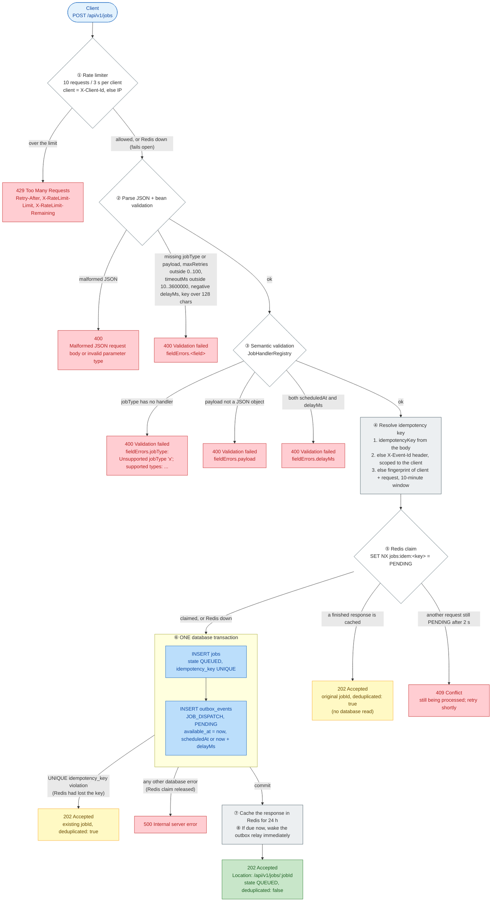
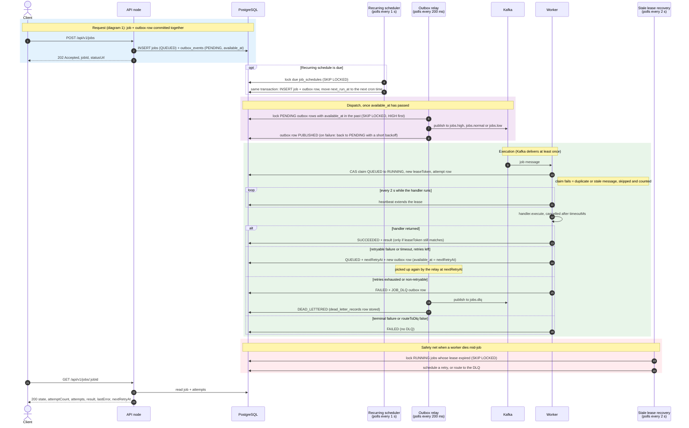
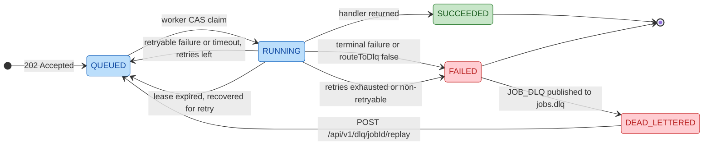

# Distributed Async Job Processing Pipeline

A production-grade, horizontally scalable asynchronous job processing pipeline built with **Java 17+**, **Spring Boot 3.4**, **Spring Kafka**, **Spring Data JPA**, **Flyway**, **PostgreSQL** and **Redis** (with **H2 + EmbeddedKafka + embedded Redis** for self-contained `mvn test` execution).

---

## Architecture Overview

```
                                   ┌───────────────────────────────────────────────┐
                                   │             PostgreSQL (Durable State)        │
  Client                           │  ┌─────────┐  ┌───────────────┐  ┌─────────┐  │
    │  POST /api/v1/jobs           │  │  jobs   │  │ outbox_events │  │job_att. │  │
    ▼                              │  └────▲────┘  └───────▲───────┘  └────▲────┘  │
┌───────────────────┐  Single DB   │       │               │               │       │
│ Stateless API     │─────────────▶│  1. Persist QUEUED + Outbox row       │       │
│ Node (Replica 1..N│◀── 202 Acc.  └───────┼───────────────┼───────────────┼───────┘
└───────────────────┘                      │               │               │
                                           │   2. Poll due outbox rows     │
                                           │   (FOR UPDATE SKIP LOCKED,    │
                                           │    ordered by priority & time)│
                                           │               ▼               │
                                           │    ┌────────────────────┐     │
                                           │    │ OutboxRelaySched.  │     │
                                           │    └──────────┬─────────┘     │
                                           │               │               │
                        ┌──────────────────┬───────────────┴──┬────────────┴──────┐
                        ▼                  ▼                  ▼                   │
                 ┌─────────────┐    ┌───────────────┐  ┌────────────┐             │
                 │  jobs.high  │    │  jobs.normal  │  │  jobs.low  │   Kafka     │
                 │ (6 parts,   │    │  (3 parts,    │  │ (2 parts,  │   Topics    │
                 │  conc = 4)  │    │   conc = 2)   │  │  conc = 1) │             │
                 └──────┬──────┘    └───────┬───────┘  └──────┬─────┘             │
                        └───────────────────┼─────────────────┘                   │
                                            ▼                                     │
                             ┌──────────────────────────────┐                     │
                             │ Stateless Worker (Replica 1..N)                    │
                             │  3. Atomic CAS claim + lease │─────────────────────┘
                             │  4. Bounded Future(timeoutMs)│
                             │  5. Lease heartbeat renewal  │
                             └──────┬───────────────┬───────┘
                                    │               │
              ┌─────────────────────┤               ├──────────────────────────────┐
              ▼                     ▼               ▼                              ▼
        [SUCCEEDED]        [Retryable &      [Non-DLQ Terminal]       [Retries Exhausted OR
      Persist JSON          attempt<=max]     (e.g. domain error       NonRetryableJobException]
       result_json         Compute jittered   / routeToDlq=false)      Mark FAILED + enqueue
                           backoff, set            │                   JOB_DLQ outbox event
                           QUEUED + nextRetryAt    ▼                              │
                           + new Outbox row     [FAILED]                          ▼
                           (NO thread sleep!)                          Publish to `jobs.dlq`
                                                                       -> Mark [DEAD_LETTERED]
                                                                       -> DeadLetterConsumer
                                                                          logs & stores DLQ row
```

### Key Distributed Guarantees

1. **Decoupled, Crash-Safe Submission (Transactional Outbox)**:
   - `POST /api/v1/jobs` validates input, writes the `jobs` row (`QUEUED`) and an `outbox_events` row (`PENDING`, `available_at = scheduledFor`) inside a **single database transaction**, and returns `202 Accepted` immediately without blocking on Kafka broker round-trips.
   - Every submission gets an idempotency key (explicit `idempotencyKey`, `X-Event-Id`, or a per-client request fingerprint). Duplicates are answered from Redis with `"deduplicated": true`, and the database `UNIQUE` constraint is the backstop when Redis is unavailable (see [Delivery Guarantees & Duplicate Execution](#delivery-guarantees--duplicate-execution)).

2. **Zero Double-Dispatch Across Replicas (`FOR UPDATE SKIP LOCKED`)**:
   - `OutboxRelayScheduler` claims due outbox batches (`available_at <= now`) using `SELECT ... FOR UPDATE SKIP LOCKED` ordered by `priority_rank ASC, available_at ASC`.
   - Immediate jobs, delayed/scheduled jobs (`scheduledAt` / `delayMs`), non-blocking retries (`nextRetryAt`), and DLQ publications all flow through this single unified crash-safe mechanism.

3. **Atomic Worker Claiming, Fencing Tokens & Stale-Running Recovery**:
   - Kafka provides at-least-once delivery. Workers claim attempts via an atomic conditional update (`WHERE id = :jobId AND status = 'QUEUED' AND attempt_count = :expectedPriorAttempt AND replay_count = :expectedReplayCount`), generating a unique `leaseToken` and `leaseExpiresAt`.
   - Active attempts periodically extend their lease via a background heartbeat. Completion and failure transitions verify `leaseToken` (plus JPA `@Version` optimistic locking) so a paused/zombie worker is fenced off.
   - `StaleJobRecoveryScheduler` uses `FOR UPDATE SKIP LOCKED` to reclaim `RUNNING` jobs whose worker crashed (`lease_expires_at <= now`), transitioning them into a scheduled retry or DLQ.

4. **Priority Queues Without Head-of-Line Blocking**:
   - Separate partitioned Kafka topics (`jobs.high`, `jobs.normal`, `jobs.low`) are paired with dedicated `ConcurrentKafkaListenerContainerFactory` instances (`concurrency`: `4` / `2` / `1`, tuned `max.poll.records`: `10` / `5` / `2`) and priority-ordered outbox polling so `HIGH` priority jobs bypass `NORMAL` and `LOW` backlogs.

5. **Strict Per-Attempt Timeout & Non-Blocking Jittered Exponential Retry**:
   - Every attempt runs on a bounded worker executor via `Future.get(timeoutMs, MILLISECONDS)`. On `TimeoutException`, `future.cancel(true)` interrupts the handler thread and treats the attempt as a retryable `JobAttemptTimeoutException`.
   - **Never sleeps on Kafka listener threads**: the retry policy is hardcoded in `RetryPolicy` (not configurable): **3 retries** (4 attempts total, overridable per job via `maxRetries`), base `1000 ms`, multiplier **`1.01`**, cap `60 s`, jitter `0.3`:
     $$\text{cappedBase} = \min(1000 \times 1.01^{\text{retry}-1},\ 60000)\ \text{ms} \qquad \text{delay} \sim \text{Uniform}\big([0.7 \times \text{cappedBase},\ \text{cappedBase}]\big)$$
     i.e. retry waits of roughly 0.7-1.0s, 0.71-1.01s and 0.71-1.02s. The delay is persisted as a deferred `JOB_DISPATCH` outbox row with `available_at = nextRetryAt`, so retries survive restarts.

---

## Job Submission Lifecycle

Three diagrams cover the whole life of a job:
- **The request** (synchronous): everything that happens inside one `POST /api/v1/jobs` before the client gets a response.
- **After the `202`** (asynchronous): how the job gets from Postgres to a worker and to a final state.
- **States**: what `GET /api/v1/jobs/{jobId}` can report.

Colour key: **red** = rejected (nothing stored), **yellow** = deduplicated (original job returned), **green** = accepted
or succeeded, **blue** = database write or waiting state, **purple** band = background dispatch. Circled numbers in
diagram 1 match the step list under it. Diagram 2 numbers every message in order.

### 1. The request: `POST /api/v1/jobs`



1. **Rate limit.** A Redis Lua sliding window keyed by client. Ops endpoints (`/api/v1/ops/**`) are exempt. If Redis is
   down the limiter lets the request through rather than taking the API down.
2. **Shape checks** from the request's annotations. Several problems are reported together in `fieldErrors`.
3. **Meaning checks.** The `jobType` must have a registered handler, the payload must be a JSON object, and
   `scheduledAt` and `delayMs` can't both be set. Nothing has been written yet, so a `400` leaves no trace. What a
   handler needs inside the payload (e.g. `message` for `echo`) is checked only when the job runs. A bad payload
   fails as non-retryable and goes to the DLQ.
4. **Idempotency key.** Every request ends up with one, so client retries never create a second job.
5. **Redis claim.** Answers repeats without touching the database. A concurrent duplicate waits up to 2 s for the first
   request to finish, then gets `409`.
6. **The transactional outbox.** The job row and its "please publish this" row commit together or not at all. Kafka is
   not called inside the request. The `UNIQUE` constraint catches duplicates if Redis had lost the key.
7. **Cache** the `202` body so later repeats are answered from Redis.
8. **Wake the relay** for immediate jobs. Delayed jobs simply wait in `outbox_events` until `available_at`.

`POST /api/v1/schedules` runs steps ② and ③ on its `job` template, reporting fields as `job.jobType` and `job.payload`.
It writes a `job_schedules` row instead of a job.

### 2. After the `202`: dispatch, execution and outcomes

Every node runs the same three pollers. None of them is a leader: they share work through
`SELECT … FOR UPDATE SKIP LOCKED`, so two nodes never take the same row.



Key points the diagram marks:
- **The outbox is the only path to Kafka.** New jobs, delayed jobs, retries, cron fires and DLQ messages are all rows
  in `outbox_events`. A delay or a backoff is just a future `available_at`, so they survive restarts.
- **The relay publishes, then marks the row `PUBLISHED`.** A crash in between means the message is published again.
  The worker's CAS claim makes that harmless.
- **The lease token fences zombies.** A worker that lost its lease can't overwrite the job. Its late result is
  discarded and flagged as a possible duplicate execution.
- **Bound on executions:** at most `(maxRetries + 1) × (1 + DLQ replays)`. See
  [Delivery Guarantees & Duplicate Execution](#delivery-guarantees--duplicate-execution).

### 3. Job states



### Response reference for `POST /api/v1/jobs`

| Status | When | Body |
| --- | --- | --- |
| `202` | Accepted | `jobId`, `state: QUEUED`, `priority`, `scheduledFor`, `statusUrl`, `deduplicated: false`, plus a `Location` header |
| `202` | Repeat of an earlier request (Redis or database) | The **original** job, `deduplicated: true`. Nothing new is created. |
| `400` | Malformed JSON | `message: "Malformed JSON request body or invalid parameter type"` |
| `400` | Bad field values, unknown `jobType`, payload not a JSON object, `scheduledAt` with `delayMs` | `message: "Validation failed"` and `fieldErrors` with one entry per problem |
| `409` | The same key is still being processed by another request after 2 s | `message: "A request with this idempotencyKey is still being processed; retry shortly"` |
| `429` | More than 10 requests in 3 s from this client | `Retry-After` header, `X-RateLimit-*` headers |
| `500` | Unexpected database failure | `message: "Internal server error"` |

Every error uses the same body: `{status, error, message, path, timestamp, fieldErrors}`.

---

## Job State Machine

`GET /api/v1/jobs/{jobId}` returns `state` as **exactly one of**:

| State | Meaning |
| --- | --- |
| `QUEUED` | Accepted and awaiting execution (initial immediate submission, future `scheduledAt`/`delayMs`, or awaiting `nextRetryAt` after a retryable failure). |
| `RUNNING` | Atomically claimed by a worker node with an active fencing `leaseToken`. |
| `SUCCEEDED` | Handler completed within `timeoutMs`; durable JSON `result` payload and `finishedAt` are populated. |
| `FAILED` | Terminal failure not published to the DLQ (e.g., `TerminalJobFailureException`, `routeToDlq=false`, or transient state immediately prior to DLQ outbox relay). |
| `DEAD_LETTERED` | Terminal failure (`maxRetries` exhausted or `NonRetryableJobException`) once published to the Kafka DLQ topic (`jobs.dlq`). |

### State Transitions

```
  POST /api/v1/jobs
         │
         ▼
     ┌────────┐   Worker CAS claim   ┌─────────┐   Handler returns JSON    ┌───────────┐
     │ QUEUED │ ───────────────────▶ │ RUNNING │ ────────────────────────▶ │ SUCCEEDED │
     └────────┘                      └─────────┘                           └───────────┘
         ▲                            │   │   │
         │   Retryable failure        │   │   │  Non-DLQ terminal failure
         │   (attempt <= maxRetries)  │   │   │  (TerminalJobFailureException
         └────────────────────────────┘   │   │   or routeToDlq=false)
          Compute jittered nextRetryAt    │   ▼
                                          │ ┌────────┐
          Exhausted maxRetries OR         └▶│ FAILED │
          NonRetryableJobException          └────┬───┘
          (with routeToDlq=true)                 │ Outbox publishes DeadLetterEnvelope
                                                 │ to Kafka `jobs.dlq`
                                                 ▼
                                         ┌───────────────┐
                                         │ DEAD_LETTERED │ ──(POST /api/v1/dlq/{id}/replay)──▶ QUEUED
                                         └───────────────┘
```

Note on `maxRetries`: `attemptCount` is 1-based. `maxRetries: N` allows **1 initial attempt + up to `N` retries** (`1 + N` total attempts). Setting `maxRetries: 0` executes once with zero retries.

---

## Idempotency & Duplicate Safety

| Layer | Mechanism |
| --- | --- |
| Submission | Every request gets an idempotency key (explicit, `X-Event-Id`, or a request fingerprint), checked in Redis first with the database as backstop (see below). Repeats, even concurrent ones, return `202` with the original `jobId` and `"deduplicated": true`. |
| Dispatch | Kafka is at-least-once. A worker only runs a message if the conditional claim (`status = QUEUED AND attempt_count = expectedAttempt-1 AND replay_count = ...`) succeeds, so duplicate/stale messages are ignored. |
| Completion | Result/failure writes are fenced by `leaseToken`, so a zombie worker cannot overwrite a recovered attempt. |
| DLQ | Dead-letter records are unique per outbox event id; redelivery is a no-op. |

## Delivery Guarantees & Duplicate Execution

**Every accepted job (`202`) is executed at least once, or ends in a visible terminal state (`DEAD_LETTERED` / `FAILED`)
after its retry budget. Exactly-once execution is not guaranteed.** State transitions are exactly-once, because claim and
completion are fenced by compare-and-set and `leaseToken`. Handler side effects are at-least-once, with a hard upper
bound (below).

### Where at-least-once is guaranteed

| Stage | Mechanism | Why the job is not lost |
| --- | --- | --- |
| Submission | Job row and outbox row commit in one transaction before `202` is returned. | A `202` means the job is durable in PostgreSQL. |
| Outbox -> Kafka | A row is marked `PUBLISHED` only after the broker acks (`acks=all`, idempotent producer). Failed publishes retry with capped backoff, indefinitely. | A relay crash between send and mark re-publishes the row. |
| Kafka -> worker | Offsets are committed only after the claim attempt. Infrastructure errors (e.g. DB down while claiming) retry in place indefinitely. | A message is never skipped because of a transient error. |
| Execution | Lease plus heartbeat. `StaleJobRecoveryScheduler` re-queues `RUNNING` jobs whose lease expired. | A worker crash or hang turns into a retry, not a stuck job. |
| Retry | The next attempt is a durable outbox row with `available_at = nextRetryAt`. | Retries survive restarts. |
| Terminal failure | A DLQ outbox row is published to `jobs.dlq`, then the job is `DEAD_LETTERED`. Replay is available via `/api/v1/dlq/{id}/replay`. | Failures are parked visibly, never dropped. |
| Recurring | The fire and the job insert are one transaction under a row lock. | A fire time is never lost between "fired" and "job created". |

### Where it is NOT guaranteed

- **Before `202`.** A timeout, connection drop, `5xx`, `429` (rate limited) or `409` (key still in flight) means no job
  may exist. The client must retry. Retrying with the same `idempotencyKey` or `X-Event-Id` is always safe.
- **Retry budget exhausted.** At-least-once means at least one attempt, not success. After `maxRetries` (default 3)
  the job is `DEAD_LETTERED` (or `FAILED` for `TerminalJobFailureException` / `routeToDlq=false`) and needs a manual replay.
- **A worker dies with `maxRetries=0`.** The lease-expired attempt counts as the only attempt, so the job goes to the DLQ
  even though the handler may have run partially or not at all.
- **Deliberate cancellation.** Ops `cancel` / `drain` turn `QUEUED` jobs into `FAILED` (`JobCancelled`).
- **Missed recurring fires.** While all replicas are down, missed fires coalesce into one catch-up run, by design.
- **Durability of the stores.** PostgreSQL is the source of truth: losing committed rows (for example, failover to an
  async replica) loses jobs. A dispatch message lost **inside Kafka after it was acked** (replication factor 1 with a
  lost disk, or a consumer group down longer than topic retention) leaves the job `QUEUED` with no message, because its
  outbox row is already `PUBLISHED`. Run Kafka with replication factor 3 and `min.insync.replicas=2`, and alert on the
  `ready` count in `GET /api/v1/ops/queue` growing while workers are idle.
- **Redis is not part of the guarantee.** If it is down, the rate limiter fails open and fingerprint dedup weakens
  (see below), but no job is lost.

### Where duplicates come from, and how each is bounded or detected

| Source | Outcome | How it is detected |
| --- | --- | --- |
| Client retry or double submit | Collapsed into one job by the idempotency key (explicit, event or fingerprint; see below). | Response `"deduplicated": true`; `jobs.submissions.deduplicated{source=redis\|database,key=explicit\|event\|fingerprint}` |
| Outbox re-publish, Kafka redelivery or rebalance | **Never executes.** The claim requires `status=QUEUED AND attempt_count=expected-1 AND replay_count=...`. | `jobs.dispatch.duplicates_skipped{reason=stale\|lost_race\|unknown_job}` |
| Worker crashed after side effects but before commit | Re-executed as the next attempt, which uses up retry budget. | Attempt row `TIMED_OUT` "Worker lease expired"; `jobs.lease.recovered`; the handler sees `attemptNumber > 1` |
| Zombie worker (GC pause or network partition outlives the lease) | May run **concurrently** with the next attempt. Its result is rejected by the `leaseToken` check. | Attempt row error message gets "late SUCCEEDED/FAILED result discarded ... (possible duplicate execution)"; `jobs.execution.fenced{outcome}` |
| Handler ignores the timeout interrupt | Keeps running while the retry runs. Its result is discarded. | `jobs.execution.completed_after_timeout` plus a WARN log naming the job and attempt |
| DLQ replay | Operator-initiated new run. | `replayCount` on the job and `replayGeneration` on each attempt |

Duplicate executions are **bounded**. A handler runs only after a successful claim, and every claim increments
`attempt_count` under compare-and-set, capped at `maxRetries + 1`. So per job:

    handler executions <= (maxRetries + 1) x (1 + number of DLQ replays)     # 4 with the defaults

Kafka and outbox duplicates never count against this bound, because they never pass the claim. Concurrent overlap is only
possible in the zombie and ignored-timeout cases, and is bounded by the same number (and by the worker thread pool).

**Making handlers safe:** use `context.jobId()` as the idempotency key for external calls and writes (it is stable across
attempts). Treat `context.attemptNumber() > 1` as "a previous attempt may have partially run". Keep I/O interruptible so
timeouts actually stop work. All counters are exposed at `/actuator/metrics/<name>`.

### Idempotency keys (Redis first, database as backstop)

Every submission gets a key, so retries are safe even when the client sends none:

| Priority | Key | Cached in Redis | Stored in `jobs.idempotency_key` |
| --- | --- | --- | --- |
| 1 | `idempotencyKey` in the body, as-is | `ttl-ms` (24h) | the key (unique forever) |
| 2 | `X-Event-Id` header: `evt:sha256(client, eventId)` | `ttl-ms` (24h) | same (unique forever) |
| 3 | Neither: `fp:sha256(client, canonical request body)` | `fingerprint-window-ms` (10 min) from the first submission | `fp:...:<epochMs / window>` |

- The client is `X-Client-Id`, or the remote IP if that header is absent. The fingerprint covers every request field,
  with JSON keys sorted, so field order doesn't matter.
- An event id is the event's identity, so a redelivered event is the same job even if its body changed. It is scoped
  per client.
- Fingerprinting collapses **identical** requests from one client within the window. To submit the same job twice on
  purpose, send distinct `idempotencyKey`s. Set `fingerprint-window-ms: 0` to disable fingerprinting.
  Clients sharing an IP without `X-Client-Id` share fingerprints.

The submission flow:

1. The first request claims `jobs:idem:<key>` with `SET NX` as a short `PENDING` marker (`pending-ttl-ms`, 30s).
2. The job is inserted, then the marker is replaced with the accepted response JSON.
3. A duplicate gets that cached response straight from Redis, with no database query. If the original is still in
   flight, the duplicate waits up to `await-ms` (2s) for it, then gets `409` and should retry.
4. If inserting the job fails, the claim is released (compare-and-delete), so the client can retry right away.

**When Redis fails** (down, evicted the key, or failed over), the database takes over. The `UNIQUE(idempotency_key)`
constraint rejects the duplicate insert, and the original job is read back and re-cached. That is the only database read,
and only on this path. Explicit and event keys stay fully deduplicated. Fingerprints are deduplicated only within the
same window bucket, so while Redis is down a retry that crosses a bucket boundary creates **at most one extra job per
boundary crossed**. With a 10-minute window, a retry 5 seconds later crosses one about 1% of the time.

### Rate limiting (10 requests per 3 seconds per client)

Every `/api/v1/**` call except `/api/v1/ops/**` counts against the caller's limit. The limit is enforced cluster-wide by
one atomic Redis Lua script (a sliding-window log in a sorted set, timed by Redis `TIME`, so every node uses the same clock).
Unlike a fixed window, a client can never fit 20 requests across a window boundary.

- The client is identified by the `X-Client-Id` header, or the remote IP if the header is absent. In production, derive
  it from the authenticated API key at the gateway, because the header is supplied by the caller.
- Every response carries `X-RateLimit-Limit` and `X-RateLimit-Remaining`. Over the limit you get `429` with
  `Retry-After` (seconds) and a JSON error body.
- If Redis is unreachable, the limiter **fails open** and logs a warning, so a Redis outage never takes the API down.
  Redis is also left out of `/actuator/health` for the same reason.

```bash
for i in $(seq 1 11); do
  curl -s -o /dev/null -w "%{http_code} " -X POST localhost:8080/api/v1/jobs -H "X-Client-Id: demo" \
    -H "Content-Type: application/json" -d "{\"jobType\":\"echo\",\"payload\":{\"n\":$i}}"
done   # 202 x10, then 429
```

## Operational Controls (`/api/v1/ops`)

These endpoints are unauthenticated; expose them only on an internal network or behind your gateway.

| Endpoint | Behaviour |
| --- | --- |
| `GET /api/v1/ops/queue` | Backlog per priority: `ready` (QUEUED and due) vs `delayed` (scheduled or awaiting retry backoff), plus `running` and `outboxPending` (not yet published to Kafka). |
| `POST /api/v1/ops/jobs/{jobId}/cancel` | Cancels one `QUEUED` job (`404` unknown, `409` if not `QUEUED`). |
| `POST /api/v1/ops/queue/drain[?priority=LOW]` | Cancels every `QUEUED` job (optionally one priority) and returns `{"cancelled": n}`. |

A cancelled job ends as `FAILED` with `lastError.type = "JobCancelled"` (the state set is unchanged). Its pending outbox
dispatch is marked `CANCELLED`; if the Kafka message was already published, the worker's conditional claim skips it.
`RUNNING` attempts are never interrupted and finish normally.

```bash
curl -s localhost:8080/api/v1/ops/queue
curl -s -X POST localhost:8080/api/v1/ops/jobs/<jobId>/cancel
curl -s -X POST "localhost:8080/api/v1/ops/queue/drain?priority=LOW"
```

## Delayed & Recurring (Cron) Jobs

**Delayed (one-off):** set `delayMs` or `scheduledAt` on `POST /api/v1/jobs`. The job is `QUEUED` immediately, but its
outbox row gets `available_at = scheduledFor`, so the relay does not publish it to Kafka before then. Past timestamps run now.

**Recurring:** a schedule stores a cron expression, a time zone and a job template. Every replica polls
`job_schedules` with `FOR UPDATE SKIP LOCKED`; for each due schedule it creates an ordinary job (same outbox, retry, DLQ and
status API) and advances `next_run_at` **in the same transaction**, so each fire time creates exactly one job cluster-wide.

| Endpoint | Behaviour |
| --- | --- |
| `POST /api/v1/schedules` | `{name, cron, timeZone?, job}` -> `201`. `job` is a normal submission body without `scheduledAt`/`delayMs`/`idempotencyKey`. `400` bad cron/zone, `409` duplicate name. |
| `GET /api/v1/schedules[/{id}]` | List or inspect: `nextRunAt`, `lastRunAt`, `lastJobId`. |
| `POST /api/v1/schedules/{id}/pause` / `resume` | Stop firing / restart from the next fire time after now. |
| `DELETE /api/v1/schedules/{id}` | Remove the schedule (jobs already created are unaffected). |

- Cron: Spring 6-field (`sec min hour day month weekday`), classic 5-field Unix cron (seconds default to `0`) or macros
  like `@hourly`. `timeZone` is an IANA id (default `UTC`), so `0 0 9 * * MON-FRI` in `Asia/Kolkata` handles the zone correctly.
- Spawned jobs carry `metadata.scheduleId` and `metadata.scheduledFireTime`.
- Missed fires (all replicas down) are coalesced into **one** catch-up run, then the schedule continues from now.
- Runs may overlap if a job takes longer than the cron interval; make the handler tolerate it or pick a wider interval.

```bash
curl -s -X POST localhost:8080/api/v1/schedules -H "Content-Type: application/json" -d '{
  "name": "daily-settlement-report",
  "cron": "0 30 9 * * MON-FRI",
  "timeZone": "Asia/Kolkata",
  "job": { "jobType": "report.generate", "priority": "HIGH", "payload": { "reportName": "settlement", "rows": 500 } }
}'
curl -s localhost:8080/api/v1/schedules
curl -s -X POST localhost:8080/api/v1/schedules/<id>/pause
```

---

## Configuration (`application.yml`)

| Property | Default | Description |
| --- | --- | --- |
| `app.jobs.defaults.timeout-ms` | `10000` | Default per-attempt execution timeout (`ms`) |
| `app.jobs.topics.high` / `normal` / `low` / `dlq` | `jobs.high`, `jobs.normal`, `jobs.low`, `jobs.dlq` | Kafka topic names |
| `app.jobs.consumer.high-concurrency` / `normal-concurrency` / `low-concurrency` | `4` / `2` / `1` | Listener concurrency per priority tier |
| `app.jobs.outbox.poll-interval-ms` | `200` | Outbox relay polling interval |
| `app.jobs.outbox.batch-size` | `50` | Outbox claim batch size per replica |
| `app.jobs.worker.lease-grace-ms` | `5000` | Extra lease buffer beyond `timeoutMs` |
| `app.jobs.worker.heartbeat-interval-ms` | `2000` | Active attempt lease extension cadence |
| `app.jobs.schedules.poll-interval-ms` | `1000` | How often each replica checks for due cron schedules (fire precision) |
| `app.jobs.schedules.batch-size` | `100` | Max due schedules fired per poll per replica |
| `spring.data.redis.host` / `port` | `localhost` / `6379` (`REDIS_HOST` / `REDIS_PORT`) | Redis for idempotency and rate limiting (250ms command timeout) |
| `app.jobs.idempotency.ttl-ms` / `pending-ttl-ms` / `await-ms` | `86400000` / `30000` / `2000` | Cached response lifetime / in-flight claim lifetime / how long a duplicate waits for the in-flight original |
| `app.jobs.idempotency.fingerprint-window-ms` | `600000` | Dedup window for requests without a key or event id (`0` disables) |
| `app.jobs.rate-limit.enabled` / `limit` / `window-ms` | `true` / `10` / `3000` | Per-client sliding-window limit |

---

## Local Startup & Testing

### Self-Contained Test Suite (No Docker Required)

Uses **EmbeddedKafka**, an **embedded Redis 6.2** server (started once per test JVM on a free port) and **H2 (PostgreSQL compatibility mode)** with Flyway migrations:

```bash
mvn clean test
```

### Running Locally with PostgreSQL & Kafka (KRaft)

```bash
# 1. Start PostgreSQL 16, Redis 7 and Apache Kafka 3.9 (KRaft mode, no ZooKeeper)
docker compose up -d

# 2. Run node 1 on port 8080
mvn spring-boot:run

# 3. (Optional) Run a second stateless node on port 8081 to exercise distributed coordination
SERVER_PORT=8081 WORKER_ID=worker-node-2 mvn spring-boot:run
```

---

## Built-in Pluggable Job Handlers & Simulation Flags

`POST /api/v1/jobs` and `POST /api/v1/schedules` only accept a `jobType` that has a registered `JobHandler` bean.
Anything else is rejected before anything is stored:

```json
HTTP/1.1 400
{ "status": 400, "error": "Bad Request", "message": "Validation failed", "path": "/api/v1/jobs",
  "fieldErrors": { "jobType": "Unsupported jobType 'invoice.sendd'; supported types: echo, report.generate, simulate, sum" } }
```

Every node must therefore ship the same handlers: deploy a new handler everywhere before clients submit its type. If a
node without the handler still receives such a job mid-rollout, it fails safely as non-retryable
(`UnsupportedJobTypeException`, sent to the DLQ).

The fields a handler needs inside `payload` are checked when the job runs, not at submission. A missing or wrong field
fails the job as non-retryable (`InvalidPayloadException`), and it goes straight to the DLQ.

| `jobType` | Expected `payload` | Sample `result` JSON |
| --- | --- | --- |
| `echo` | `{"message": "hello"}` | `{"echo":"hello","attempt":1,"priority":"NORMAL","processedBy":"..."}` |
| `sum` | `{"numbers": [10, 20, 12.5]}` | `{"sum":42.5,"count":3,"min":10.0,"max":20.0,"average":14.166...}` |
| `report.generate` | `{"reportName": "q4-revenue", "rows": 500}` | `{"reportName":"q4-revenue","rowsProcessed":500,"checksum":"...","attempt":1}` |
| `simulate` | `{"resultValue": {"ok": true}}` | `{"simulated":true,"attempt":1,"priority":"NORMAL","resultValue":{"ok":true}}` |

Any job payload can also include optional simulation directives to exercise failure & timeout paths:
- `"simulateDelayMs": 3000` — sleeps `3000ms` (interruptible by `timeoutMs`)
- `"simulateFailures": 2` — throws retryable `SimulatedTransientFailureException` on attempts `1..2`, then succeeds on attempt `3`
- `"simulateAlwaysFail": true` — throws retryable `SimulatedTransientFailureException` on every attempt until `maxRetries` exhausts -> `DEAD_LETTERED`
- `"simulateNonRetryable": true` — throws `InvalidPayloadException` (`NonRetryableJobException`), bypassing retries -> `DEAD_LETTERED`
- `"simulateTerminalFailure": true` — throws `TerminalJobFailureException`, transitioning directly to `FAILED` without DLQ publication

---

## API Walkthrough (`curl` Examples)

### 1. Immediate Job Submission (`202 Accepted` + Result Retrieval)

```bash
curl -i -X POST http://localhost:8080/api/v1/jobs \
  -H "Content-Type: application/json" \
  -d '{
    "jobType": "sum",
    "priority": "NORMAL",
    "payload": { "numbers": [10, 20, 30, 40] },
    "idempotencyKey": "sum-req-001",
    "metadata": { "requestedBy": "billing-service" }
  }'

# Check status, timestamps, attempt history, and persisted JSON result:
curl -s http://localhost:8080/api/v1/jobs/<jobId>
```

### 2. High-Priority Job (`jobs.high`)

```bash
curl -s -X POST http://localhost:8080/api/v1/jobs \
  -H "Content-Type: application/json" \
  -d '{
    "jobType": "echo",
    "priority": "HIGH",
    "payload": { "message": "urgent-alert" }
  }'
```

### 3. Deferred / Scheduled Job (`delayMs` or ISO-8601 `scheduledAt`)

```bash
# Relative delay (5 seconds)
curl -s -X POST http://localhost:8080/api/v1/jobs \
  -H "Content-Type: application/json" \
  -d '{
    "jobType": "report.generate",
    "delayMs": 5000,
    "payload": { "reportName": "daily-settlement", "rows": 1200 }
  }'

# Explicit future timestamp
curl -s -X POST http://localhost:8080/api/v1/jobs \
  -H "Content-Type: application/json" \
  -d '{
    "jobType": "echo",
    "scheduledAt": "2026-12-31T23:59:00Z",
    "payload": { "message": "year-end-close" }
  }'
```

### 4. Transient Failures -> Non-Blocking Jittered Retry -> `SUCCEEDED`

```bash
curl -s -X POST http://localhost:8080/api/v1/jobs \
  -H "Content-Type: application/json" \
  -d '{
    "jobType": "echo",
    "maxRetries": 3,
    "payload": {
      "message": "eventual-success",
      "simulateFailures": 2
    }
  }'
```

### 5. Per-Attempt Timeout Enforcement -> Retry -> Exhaustion -> `DEAD_LETTERED`

```bash
curl -s -X POST http://localhost:8080/api/v1/jobs \
  -H "Content-Type: application/json" \
  -d '{
    "jobType": "simulate",
    "timeoutMs": 200,
    "maxRetries": 1,
    "payload": { "simulateDelayMs": 5000 }
  }'
```

### 6. Non-Retryable Failure -> Immediate DLQ (`DEAD_LETTERED`)

```bash
curl -s -X POST http://localhost:8080/api/v1/jobs \
  -H "Content-Type: application/json" \
  -d '{
    "jobType": "sum",
    "maxRetries": 5,
    "payload": { "numbers": ["not-a-number"] }
  }'
```

### 7. Non-DLQ Terminal Failure (`FAILED`)

```bash
curl -s -X POST http://localhost:8080/api/v1/jobs \
  -H "Content-Type: application/json" \
  -d '{
    "jobType": "simulate",
    "payload": { "simulateTerminalFailure": true }
  }'
```

### 8. Inspect & Replay Dead-Lettered Jobs

```bash
# List all DLQ records
curl -s http://localhost:8080/api/v1/dlq

# Inspect DLQ diagnostics for a specific job
curl -s http://localhost:8080/api/v1/dlq/<jobId>

# Replay a DEAD_LETTERED job back to QUEUED
curl -i -X POST http://localhost:8080/api/v1/dlq/<jobId>/replay
```
